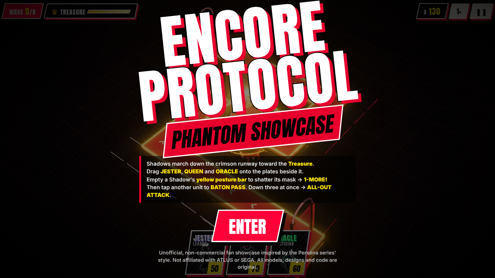
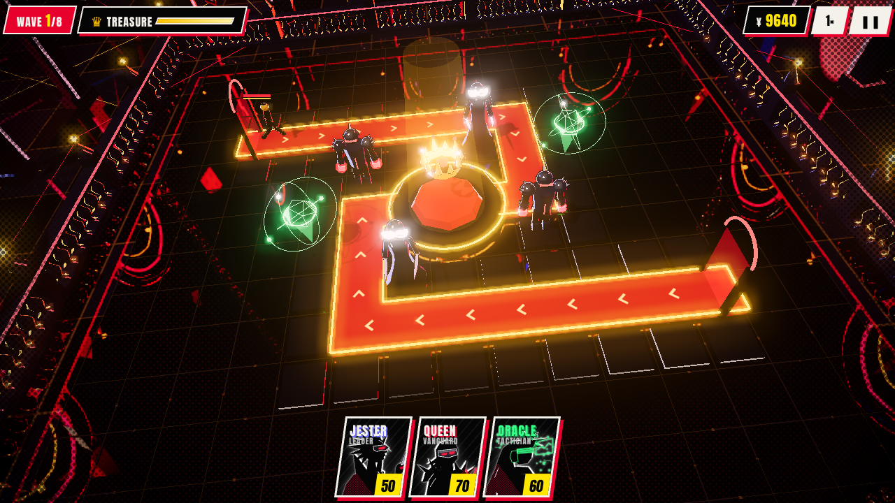
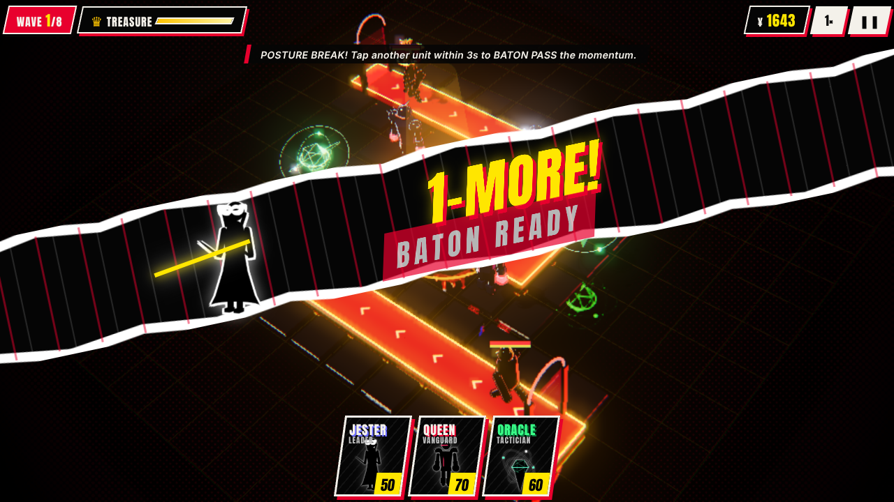
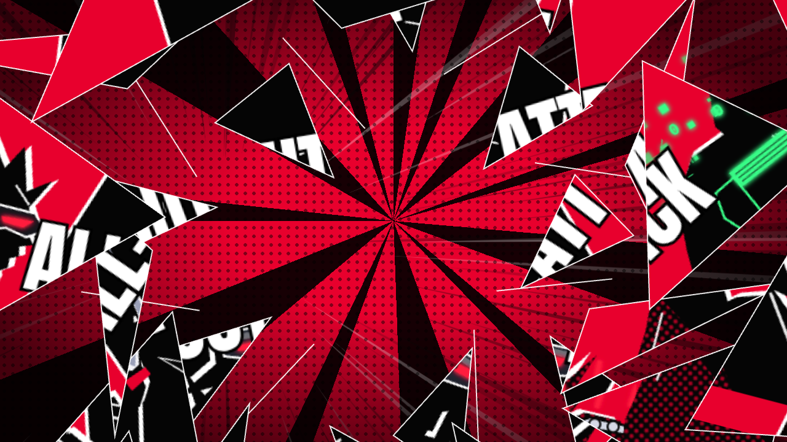
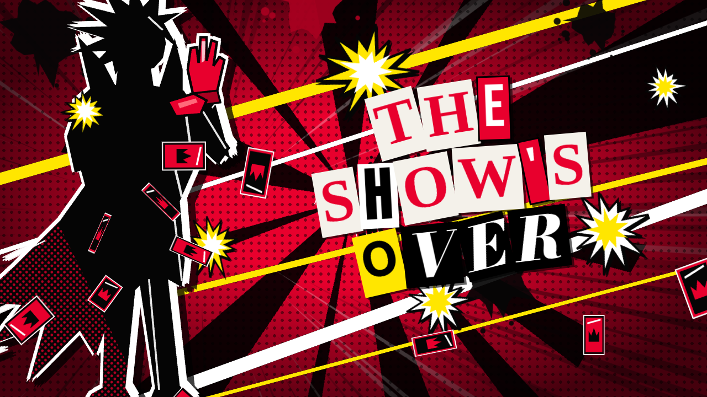
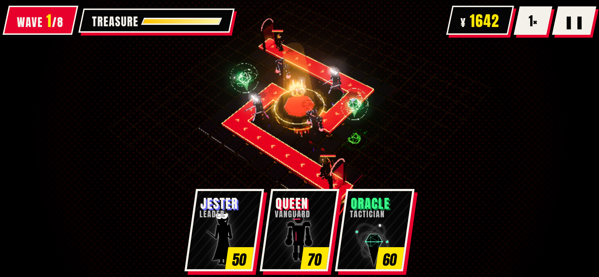
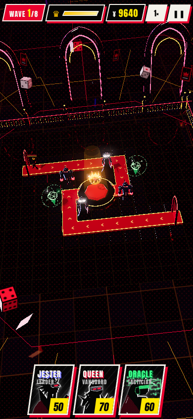

# ENCORE PROTOCOL · Phantom Showcase

### A stylized 3D tower defense in Three.js · cel-shaded · set in a neon Palace · built for phones



Shadows march down a crimson runway toward a floating golden **Treasure**. Deploy your Phantoms beside
it, **break their posture** to shatter their gold masks, chain **1-MORE → Baton Pass**, and when three are
down, tap the flashing prompt for an **ALL-OUT ATTACK**.

| | |
| --- | --- |
|  |  |
|  |  |
|  |  |

> ⚠️ **Fan project.** This is an unofficial, non-commercial showcase inspired by the Persona series' visual
> style. It is not affiliated with ATLUS or SEGA. It contains **no ripped or copied game assets**, and every
> model, character design, effect and UI element is original and built in code (see [NOTICE.md](NOTICE.md)).

## Play on your phone

**Option A: GitHub Pages (recommended)**

1. On GitHub, go to repo **Settings → Pages**. Under **Build and deployment**, set the source to **GitHub Actions**.
2. Merge this branch into `main`, or open **Actions → Deploy to GitHub Pages → Run workflow**.
3. Open `https://<your-user>.github.io/p5_tower_defense/` on your phone.
   Tip: use "Add to Home Screen" for a full-screen launch.

> GitHub Pages on a **private** repo needs a paid plan (Pro/Team/Enterprise). On a free account,
> either make the repo public or use option B.

**Option B: from your computer, on the same Wi-Fi**

```bash
npm install
npm run dev          # prints a "Network:" URL such as http://192.168.1.20:5173 – open it on your phone
```

## Controls

| | Touch | Mouse / keys |
| --- | --- | --- |
| Deploy | Drag a card onto a plate beside the runway, or tap a card then tap a plate | same |
| Inspect / sell | Tap a deployed unit | click · `Esc` closes |
| Baton Pass | After **1-MORE!**, tap another unit within 3 s | click |
| All-Out Attack | Tap the flashing crimson **ALL-OUT ATTACK** prompt | `A` |
| Speed / pause | `1×` and `❚❚` buttons | `Space` pauses |

## What's in it

- **3D arena** (Three.js, WebGL):
  - The battle camera sits close at (0, 9, 8) looking at the centre with a −6° Dutch tilt. Its FOV adapts so every build plate fits any phone.
  - **1-MORE** and **Baton Pass** spring the camera into a punch-in zoom that snaps to a −8° Dutch tilt.
  - The title and results screens use a low, drifting establishing shot of the whole Palace, then glide down into the battle view.
  - The floor is reflective obsidian (`#0A0A0E`).
  - A raised crimson runway (`#D90429`) has emissive gold neon edges and marching chevrons.
  - The Treasure is a floating, spinning geometric crown.
- **The Palace** around it (`src/render/palace.js`, about 25 draw calls, all instanced or merged):
  - A velvet `FogExp2(0x0c0714, 0.025)` haze over a mirror-glossy marble checkerboard that runs to the horizon, etched with a neon circuit matrix.
  - A distant neon skyline with gothic spires, giant wireframe roulette wheels, and golden chains hanging out of the dark.
  - Gothic balustrades and glowing pointed archways around the board, with dice and calling cards floating past.
- **Cel-shading everywhere**:
  - `MeshToonMaterial` uses a hard 3-step ramp, plus an injected hard-cutoff specular and a sharp rim light.
  - Meshes get inverted-hull ink outlines.
  - Directional key and rim lights cast sharp shadows.
- **Post-processing**:
  - Bloom on the neon.
  - A Ben-Day halftone shader that bites into the screen corners and the deepest shadows.
  - Chromatic aberration on posture breaks.
- **Phantoms** (original stylized figures, faceless by design):
  - **Jester** (Leader): a long flared black trench coat, popped collar, a glowing white masquerade mask and twin silver blades.
  - **Queen** (Vanguard): navy armor, metallic spiked pauldrons and crimson knuckle auras. Heavy posture damage with splash.
  - **Oracle** (Tactician): a floating neon-green icosahedral drone pod with holographic orbital rings. Its long-range marks slow Shadows and expose their posture.
- **Shadows**: faceless glossy obsidian mannequins in gold porcelain masks, with glowing yellow eyes and a marching walk cycle. There are four kinds, including a crowned boss.
- **Posture Break**: an 80 ms hit-stop, then the mask **shatters into golden shards** and **black/red ink** erupts. The Shadow drops to its knees and takes ×1.5 damage.
- **Comic silhouettes** (`src/ui/silhouettes.js`): hand-authored angular SVG art for each Phantom. Each one has ink fill, a white offset rim light, halftone shading and hatch strokes, and no facial features:
  - **Jester**: a side profile with swept razor locks, a popped collar, a masquerade mask with a crimson eye-slit and a raised dagger.
  - **Queen**: a 3/4 combat stance with spiked rider pauldrons, a visor with twin red glows and a knuckle-duster fist.
  - **Oracle**: a whipping angular mane, headphones, holo visor glasses and a matrix of digital particles.
- **1-MORE screen-slice**: a −12° torn-paper band rips across the screen. It has a white paper backing with a red drop shadow, Ben-Day dots, heavy speedlines converging on the silhouette, a blade-swipe slash, and a yellow **1 MORE!** on an exploding star.
- **ALL-OUT ATTACK**:
  1. The game freezes and a 3-panel comic wipe plays.
  2. The frozen frame **shatters like glass** into a red/black splash. A full-body **leader hero silhouette** (coat tails torn back, pulling a crimson glove tight) stands beside the ransom-note **THE SHOW'S OVER**. Around them: yellow and white accent cuts, ink splatters, exploding comic stars and fluttering calling cards.
  3. Calling cards rain across the arena.
- **8 waves**, including a boss wave. The difficulty is tuned so that, by test, a good build **needs** the Baton Pass / All-Out mechanics to win.
- **Comic HUD**: deploy cards skewed −6° with jagged white frames, halftone faces and yellow burst price badges, set in bold slanted all-caps type throughout.
- **Mobile-first**:
  - Touch and drag input, a responsive HUD for portrait and landscape, and safe-area insets.
  - Adaptive resolution that lowers the pixel ratio if frames drop.
  - `?q=low` turns off bloom and shadows.

## Develop

```bash
npm install
npm run dev        # Vite dev server (LAN-accessible)
npm test           # 12 headless simulation tests incl. balance guard rails
npm run build      # production build -> dist/
npm run smoke      # browser e2e against the build (needs: npm i -D playwright && npx playwright install chromium)
npm run smoke:assets  # same, with the CC0 placeholder glTF models + PNG cut-ins dropped in
```

**Your own art:** put `.glb` models in `public/models/` and PNG cut-ins in `public/portraits/`, or in their
git-ignored `custom/` folders for local-only art. Models are auto-scaled to 1.8 units, grounded, cel-shaded and
ink-outlined; anything missing falls back to the built-in art. See [docs/ASSETS.md](docs/ASSETS.md).

```
src/
  sim/      pure deterministic game logic (no DOM / Three.js): board, units, enemies, waves, posture, baton, all-out
  render/   Three.js: toon materials + outlines, arena, models, FX pools, camera rig, post-processing
  ui/       DOM HUD, comic cut-ins (1-MORE, ALL-OUT shatter), SVG silhouettes + comic kit (stars, ink, speedlines, torn paper), CSS
  assets/   drop-in art manifest + custom/ -> base -> built-in resolver
  main.js   renderer setup, input, game loop, cut-in orchestration
```

See [docs/DESIGN.md](docs/DESIGN.md) for rules and rendering details, and [docs/ROADMAP.md](docs/ROADMAP.md) for what's next.
The previous 2D canvas version (v0.2) lives in git history at commit `64bc6fb`.

---

*Persona is a trademark of ATLUS. This is an unofficial fan work. Code is MIT-licensed.*
