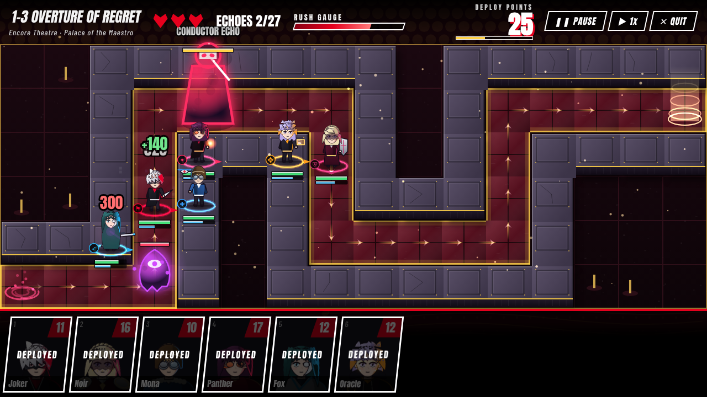
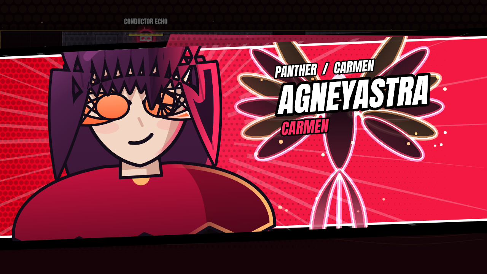
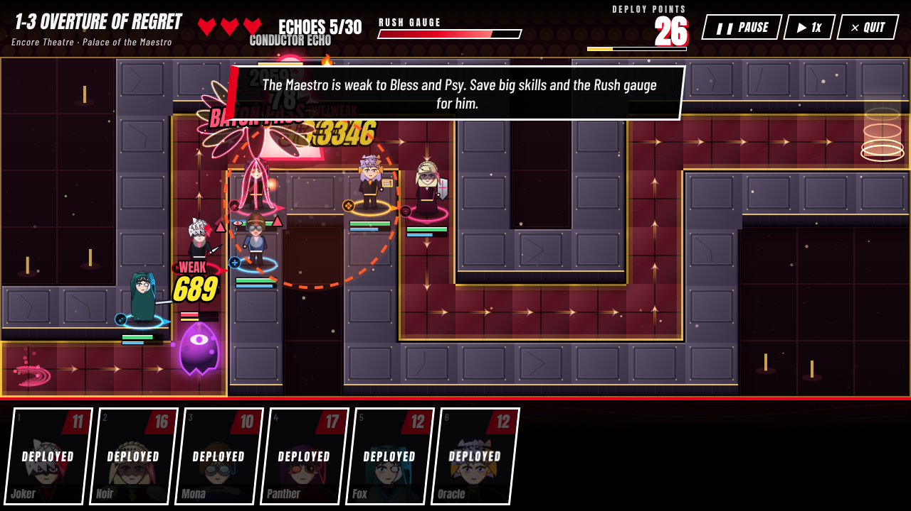
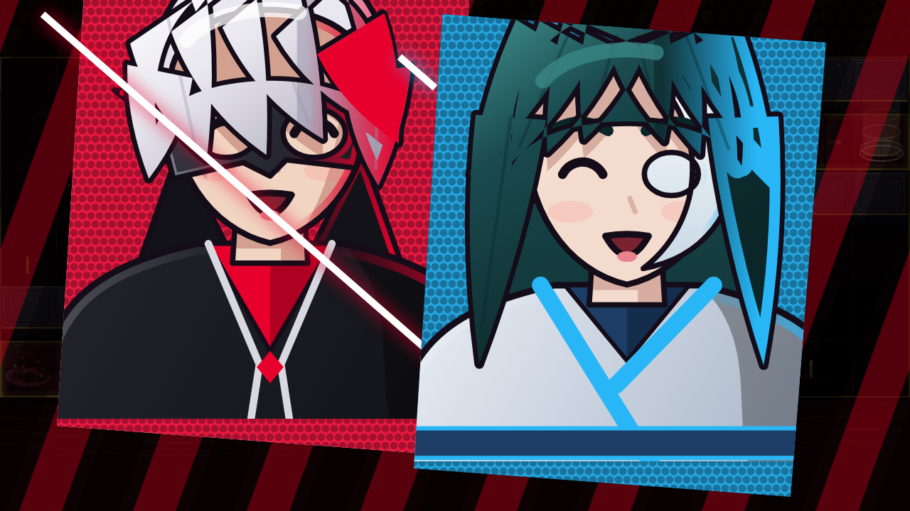
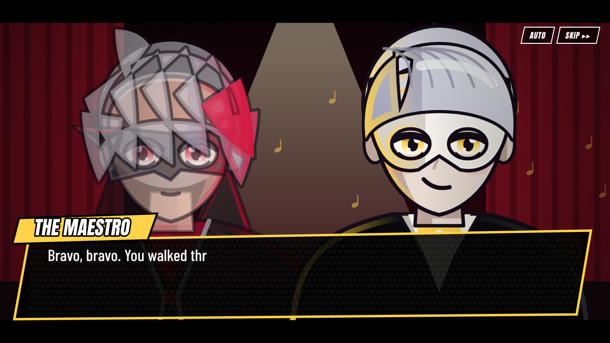
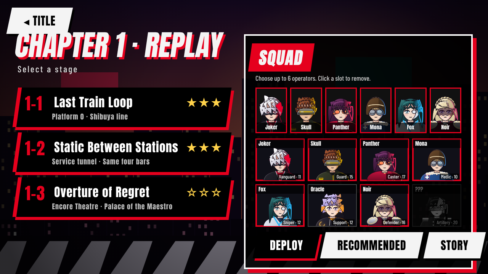
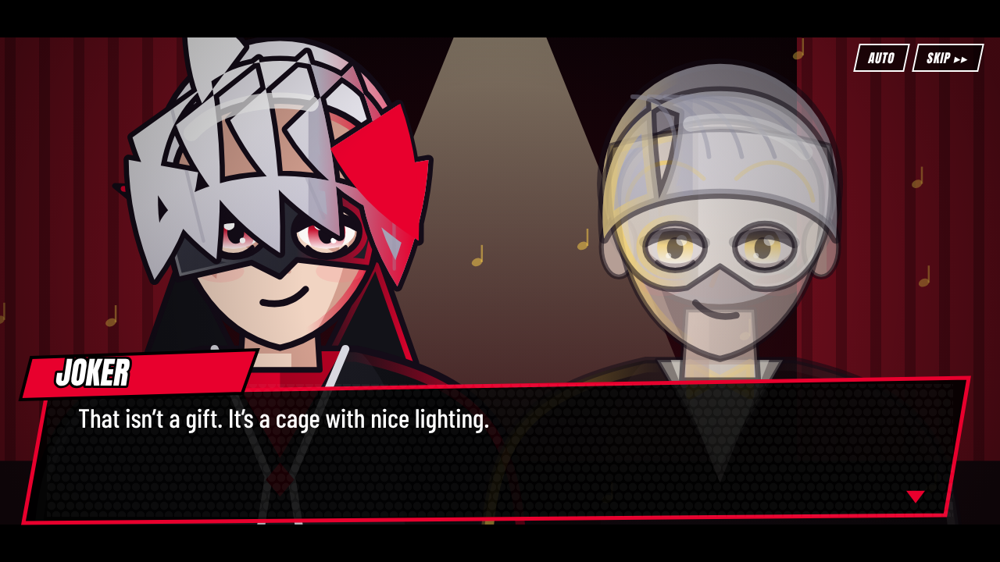
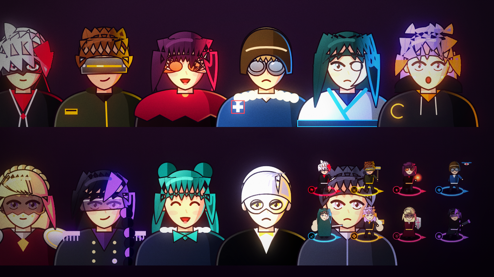

# ENCORE PROTOCOL

### A *Persona 5* fan tower defense · Arknights-style combat · original post-game story


> One summer after the Phantom Thieves changed the world, the trains stop. People stand frozen on the
> platforms, smiling, mouthing four bars of a song. There is no Palace on the map, only a new layer
> **beneath** Mementos. The Thieves go under.

**Encore Protocol** is a browser tower defense where the Phantom Thieves are your operators. Deploy them
on a grid, block and shoot "Echoes" (replays of regret), exploit elemental weaknesses to knock enemies
**DOWN**, chain **Baton Passes**, and unleash a cinematic **All-Out Rush**, with a story that picks up
*after* the original game.

| | |
| --- | --- |
|  |  |
|  |  |
|  |  |
|  |  |

> ⚠️ **Fan project.** Unofficial and non-commercial; not affiliated with ATLUS/SEGA. This repo contains **no
> ripped game assets**. All visuals and audio are original and procedurally generated. The operators and
> their summoned spirits use **original Encore Protocol designs** and are not recreations of the game's
> character art. See
> [NOTICE.md](NOTICE.md) and [docs/ASSETS.md](docs/ASSETS.md) for how to plug in art you own.

## Play

```bash
git clone <this repo> && cd p5_tower_defense
npm start            # → http://localhost:8080   (no dependencies, Node ≥ 18)
```

Any static file server works too (`python3 -m http.server`); the game is plain ES modules + Canvas, no build step.

## What's in the vertical slice (v0.1)

- **Core TD loop**: DP economy, deploy + facing, blocking, melee-on-path / ranged-on-high-ground,
  redeploy cooldowns, retreat refunds, 3-star ratings, 2× speed, pause, slow-motion while placing.
- **8 operators**, each with a unique class, Persona, and **unique animated skill + full-screen cut-in**:

  | Operator | Class | Skill |
  | --- | --- | --- |
  | Joker | Vanguard | Arsène · Eiha Rebellion |
  | Skull | Guard | Captain Kidd · Thunder Reign |
  | Panther | Caster | Carmen · Agneyastra |
  | Mona | Medic | Zorro · Mediarama Gale |
  | Fox | Sniper | Goemon · Diamond Dust |
  | Oracle | Support | Al Azif · Full Scan |
  | Noir | Defender | Milady · Gran Aegis |
  | Queen | Artillery | Johanna · Atomic Overdrive |

- **Persona combat language**: elemental **weakness → Stagger → DOWN**, **Baton Pass** on every skill,
  the **Rush gauge** and **All-Out Rush**.
- **Enemies ("Echoes")**: 4 regulars, a Conductor mini-boss that summons, and **The Maestro**, a multi-phase
  boss with a Crescendo AoE and an **Encore** revival.
- **Chapter 1 · REPLAY**: 3 stages, ~95 lines of original story, 4 scripted cinematics, mid-battle
  story beats, unlock progression, save data.
- **Presentation (v0.2 art pass)**:
  - A post-processing pipeline with bloom, colour grading, chromatic aberration on impacts, film grain
    and vignette.
  - Dynamic lighting driven by units and FX.
  - 2.5D lit battlefields with raised high ground, emissive trims, animated gates and flowing route energy.
  - Cel-shaded character busts with rim light and expressions.
  - Animated chibi battle tokens and light-built summoned spirits.
  - Halftone and speed-line cut-ins, typed dialogue with camera FX, and a procedural synth soundtrack.
- **Graphics quality**: Auto, High, Low or Off in Settings. Auto steps down by itself on slow devices.
- **Accessibility**: reduce-flashing and screen-shake toggles, adjustable text speed, auto-advance.

## Controls

| | |
| --- | --- |
| Deploy | Click a card (or press `1`–`6`) → click a green tile → move the mouse to aim the facing → click. Or drag a card onto the map. |
| Select / inspect | Click a deployed operator to see range and skill. |
| Skill | `S` or the SKILL button when SP is full (plays the cut-in) |
| Retreat | `R` or the RETREAT button (refunds half the cost) |
| All-Out Rush | `A` when the Rush gauge is full |
| Pause / speed | `Space` / `F` |
| Cancel | `Esc` or right-click |
| Cutscenes | Click / `Space` to advance, `Esc` or SKIP to skip, AUTO to auto-advance |

## Develop

```bash
npm test             # 32 headless tests: data integrity, combat rules, every skill, balance guard rails
npm run smoke        # real-browser end-to-end (needs: npm i -D playwright && npx playwright install chromium)
```

Docs:

- [docs/DESIGN.md](docs/DESIGN.md): mechanics, damage model, classes, Echoes, architecture
- [docs/STORY_BIBLE.md](docs/STORY_BIBLE.md): premise, themes, original cast, chapter beats, hook
- [docs/ASSETS.md](docs/ASSETS.md): legal policy + how to bring your own art
- [docs/ROADMAP.md](docs/ROADMAP.md): path from vertical slice toward "AAA" polish
- [CONTRIBUTING.md](CONTRIBUTING.md), [CHANGELOG.md](CHANGELOG.md), [NOTICE.md](NOTICE.md)

```
src/
  sim/      pure deterministic combat (no DOM), the testable source of truth
  render/   canvas: field, characters, personas, skill FX, cut-ins, cinematics
  scenes/   title · hub/squad · battle (input + HUD) · cutscene player · roster · settings
  data/     operators, enemies, stages, story script, procedural "looks"
  core/     WebAudio synth, save data, asset override loader, math utils
```

## Honest status

This is a **vertical slice**, not a finished AAA game. The mechanics, UX, animation systems and story
structure are in place and tested. The v0.2 art pass gave everything a lit, post-processed, cel-shaded look,
but all of it is still drawn in code. Hand-painted illustration and keyframed animation would be the next
step up; the asset-override system and the [roadmap](docs/ROADMAP.md) are the path there.

---

*Persona is a trademark of ATLUS. This is an unofficial fan work released under the MIT license for its original code and writing.*
